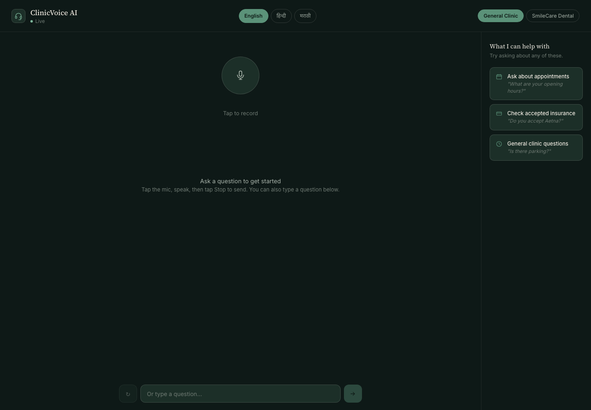
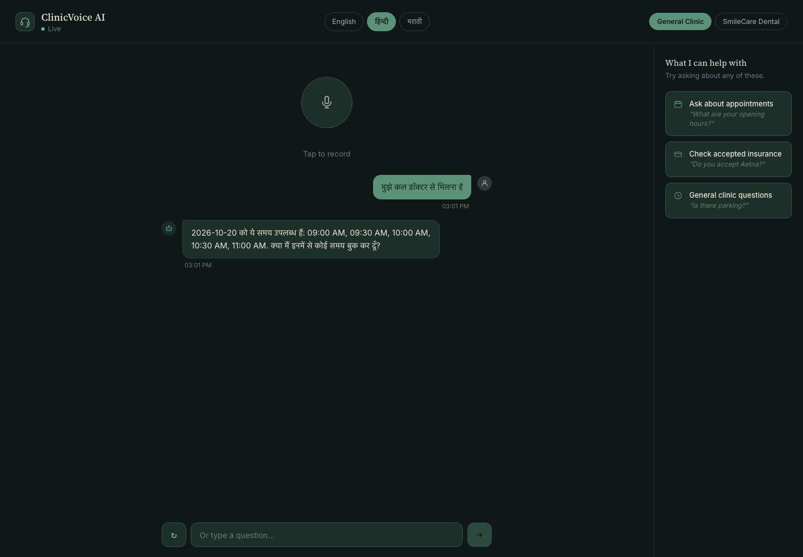
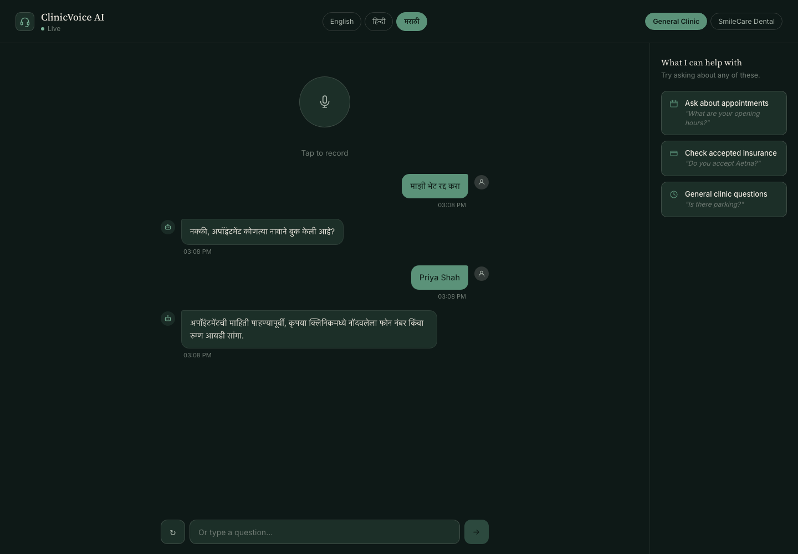

# ClinicVoice AI: Multilingual Voice Assistant for Clinic Reception

**Live application:** https://clinicvoice-ai.onrender.com/

ClinicVoice AI is a voice-first receptionist for medical and dental clinics. A patient can ask clinic questions, request an appointment, ask for a refill, or leave a message for the care team by speaking or typing. The assistant speaks its answer back and supports English, Hindi, and Marathi.

This project is designed to demonstrate how a conversational AI system can connect a polished voice interface to real workflows while keeping sensitive actions behind explicit checks. Appointment lookup, cancellation, and rescheduling require a clinic-registered phone number or patient ID before the calendar is accessed. The demo uses a local SQLite calendar by default; Google Calendar and FHIR sandbox adapters are also included.

> This is a software engineering demo, not a medical device. It does not diagnose conditions, recommend treatment, or replace clinic staff.

## Product Screenshots

### Voice Assistant Home

### Hindi Appointment Booking

### Marathi Appointment Verification

The screenshots show actual responses from the local demo services. The appointment calendar is populated with test data.

## What Patients Can Do

### Ask questions about a clinic

Patients can ask about opening hours, parking, accepted insurance, and other clinic-specific FAQs. The assistant searches the clinic's FAQ collection, then uses a language model to turn relevant material into a concise reply. If the search does not find enough support, the assistant falls back instead of inventing clinic policy.

### Request an appointment

The assistant collects a requested date, checks available slots, and asks the patient to choose a time. It only creates a booking after the patient selects an available slot. The demo calendar is SQLite, so a local setup does not need a Google account or calendar credentials.

### Look up, cancel, or move an appointment

These are protected actions. The assistant first asks which patient's appointment to find, then asks for a phone number or patient ID already present in the clinic-managed registry. It checks the supplied value against that registry before reading or changing the calendar. A name or identifier typed into the chat cannot register itself as valid.

The verification challenge expires after five minutes and allows three attempts. Missing registry entries or ambiguous appointment matches are sent to reception. New appointment bookings do not require this existing-patient registry.

### Request a prescription refill

The assistant records the patient's name and medication name, then logs a refill request for clinic staff to review. It does not approve or change a prescription and does not ask for dosage details.

### Leave a note for the care team

Patients can describe a symptom, test result, prescription question, or administrative request. The assistant records a short intake category and, when relevant, a general body area. It does not diagnose the issue; urgent symptoms are routed to the emergency guidance path.

### Reach a person

A patient can ask for a receptionist or express a complaint. The assistant directs them to the clinic's reception team.

## Voice and Language Experience

The interface has a language selector for English, Hindi, and Marathi, plus a clinic selector for the included demo clinics. Patients can speak or type. The repeat button plays the last answer again without submitting another request. Starting a new language or clinic conversation clears the previous session.

The browser uses its speech recognition API when available. If recognition is missing or fails, the patient can tap the microphone to record a clip and tap Stop to send it for server transcription. Groq Whisper transcribes the recording using the selected language. English audio replies use the hosted text-to-speech endpoint; Hindi and Marathi use the browser's installed speech voice. If audio cannot play, the text answer remains visible.

A waiting message appears when the first response takes longer than usual. This is useful on the free hosted demo, where services may need time to wake after inactivity.

## How a Request Flows Through the System

The app is split into a React voice client, a Python clinic workflow service, and a Node FAQ and speech service.

    Patient speaks or types
             |
             v
    React voice client
      |-- browser speech recognition when available
      |-- recorded audio fallback -> Node transcription endpoint
             |
             v
    Python FastAPI agent service
      |-- request and safety checks
      |-- language-aware intent routing
      |-- booking, refill, insurance, intake, handoff, or FAQ agent
             |
      +------------------------------+
      |                              |
      v                              v
    Clinic tools                 Node FAQ service
    calendar, waitlist,          FAQ retrieval and answer generation
    intake/refill logs           Groq primary -> Gemini failover
      |                              |
      +---------------+--------------+
                      |
                      v
      Localized text and spoken answer

Each request has a request ID that is passed between services and written to structured logs, so a slow or failed request can be traced across the system.

### FAQ retrieval and answer generation

The FAQ service ranks clinic content with a hybrid retrieval method: BM25 keyword matching catches exact terms, while character trigrams help match spelling variants and multilingual text. The service checks safety and retrieval confidence before requesting a generated answer. Groq is the default answer provider; Gemini is the configured fallback for transient failures such as timeouts, rate limits, and provider server errors. Authentication errors, invalid requests, malformed responses, and provider safety blocks do not trigger a retry at another provider.

Generated answers still pass through output checks. The provider name, model, latency, and token count can be logged without logging the prompt and answer in the provider log line.

### Deterministic workflows

Appointment, refill, insurance, and intake agents use explicit code and session state for each step. The language model does not choose a time slot, create a booking, verify a patient, or decide whether a prescription should be renewed. This makes those actions easier to test and keeps the calendar operation separate from free-form answer generation.

## Safety and Privacy Design

- **Emergency routing:** urgent symptom language is directed to emergency guidance instead of a routine FAQ answer.
- **Input checks:** blocks requests for diagnosis, medication dosing, prompt injection, or another patient's private information.
- **Intent routing:** sends workflow requests to the relevant agent; an optional LLM classifier is available behind a feature flag when the rules have low confidence.
- **FAQ confidence checks:** returns a fallback when retrieved clinic information is not strong enough to support an answer.
- **Output review:** checks generated replies; an optional compliance reviewer can be enabled for an additional pass.
- **Appointment verification:** checks a registered identifier before calendar lookup, cancellation, or rescheduling.
- **Clinic separation:** the selected clinic ID is carried through sessions and service calls; each clinic loads its own configuration.

The demo uses a clinic-managed patient registry file for registered phone numbers and patient IDs. Treat that file as private operational data: keep it out of Git, limit file access, and replace the demo setup with authenticated patient accounts and one-time codes before a production deployment.

## Supported Clinics and Integrations

Two example clinic profiles are included: a general clinic and SmileCare Dental. A clinic profile holds operating hours, doctors, accepted insurance providers, FAQs, timezone settings, a scheduling adapter, and optional webhooks. The second clinic can be customized through its configuration file rather than changing the agent logic.

Scheduling adapters include:

- **SQLite demo calendar:** the default for local demos and offline evaluation.
- **Google Calendar adapter:** for a clinic calendar configured with the required credentials.
- **FHIR R4 sandbox adapter:** an integration example for a test environment, not a production EHR connection.

The system also includes optional feature-flagged implementations for a LangGraph orchestrator, MCP tool transport, hybrid LLM routing, a compliance reviewer, and an Ollama-based semantic cache. The default path stays lightweight; the alternatives can be compared against the same offline evaluation cases.

## Architecture

    Browser / React
       |
       |  JSON requests with a shared request ID
       v
    Python FastAPI service :8000
       |-- safety and emergency handling
       |-- language-aware router
       |-- deterministic workflow agents
       |-- clinic scheduling and logging tools
       |-- SQLite session and demo data
       |
       v
    Node.js / Express service :5050
       |-- clinic FAQ retrieval
       |-- Groq / Gemini answer generation
       |-- Groq speech transcription and English TTS

The FAQ service also exposes health checks and a GraphQL endpoint for FAQ data. The Python service exposes a health check, readiness check, query endpoint, and a small admin dashboard with request, latency, failure, and tool statistics.

## Evaluation Results

The offline evaluation uses committed cases, a fake calendar, no network calls, and no language-model calls. It checks workflows and routing against expected outcomes. The table shows the latest committed legacy-orchestrator run; results are reproducible with the commands below.

| Area | Cases | Result |
|---|---:|---:|
| FAQ retrieval | 53 | 91.2% hit at 1; 98.1% decision accuracy |
| Appointment booking | 25 flows | 100% pass |
| Refill requests | 12 flows | 100% pass |
| Insurance | 12 | 100% accuracy |
| Escalation | 12 | 100% accuracy |
| Hindi and Marathi | 21 combined | 100% pass |
| Routing | 36 | 100% accuracy |
| Safety: unsafe and safe requests | 30 | 100% catch rate; 0% false positives |

The original baseline is recorded alongside the full case-level output in the evaluation artifacts. FAQ retrieval still misses a small number of paraphrases; a high score on a fixed test set does not guarantee a correct answer to every question.

### Red-team results

The red-team harness contains 46 examples across prompt injection, medical advice, identity bypass, other-patient data requests, and Hindi/Marathi attacks. The first safety layer caught 40 of 46; the blocklists in the Python and Node services had zero measured drift. The six not caught by the first layer are reported in the harness results. Some appointment-related prompts continue into the protected booking flow and must be checked end to end; the first-layer score alone is not a privacy guarantee.

The red-team cases and detailed outcomes are in [RED_TEAM.md](RED_TEAM.md). The offline eval and threshold files are in [python-eval/results](python-eval/results).

## Quickstart

### 1. Start the backend services

Requirements: Docker with Docker Compose, or Python 3.11 and Node.js 22 for a native setup.

For the Docker setup, copy the example environment file and start the API services:

    cp .env.example .env
    docker compose up --build

The FAQ service listens on port 5050. The agent service listens on port 8000. The demo calendar and session state use local persistent storage.

### 2. Start the web client

In another terminal:

    cd cloud-frontend
    npm ci
    VITE_API_URL=http://localhost:5050 VITE_AGENT_URL=http://localhost:8000 npm run dev

Open http://localhost:5173.

For FAQ answers, transcription, and English hosted speech, add a Groq API key to the root .env file. Add a Gemini API key to enable provider failover. Never commit .env or clinic registry data.

### 3. Try the API directly

    curl -s http://localhost:8000/api/agent-query \
      -H 'Content-Type: application/json' \
      -d '{"query":"I want to book an appointment tomorrow","session_id":"demo","language":"en"}'

The request body accepts:

- query: the text to route through the receptionist.
- session_id: a conversation identifier used to keep multi-turn workflow state.
- clinic_id: optional clinic profile identifier, such as default or smilecare.
- language: en, hi, or mr; used for transcription, prompts, and browser playback.

### Example service endpoints

| Service | Endpoint | Purpose |
|---|---|---|
| Agent service | GET /health | Basic service health |
| Agent service | GET /ready | Checks FAQ service and calendar availability |
| Agent service | POST /api/agent-query | Routes a conversation turn |
| Agent dashboard | GET /dashboard | Recent requests and operational metrics |
| FAQ service | GET /api/health | FAQ service health |
| FAQ service | POST /api/text-query | FAQ retrieval and answer generation |
| FAQ service | POST /api/transcribe | Speech-to-text for recorded audio |
| FAQ service | POST /api/tts | English text-to-speech |

### Register demo patients for protected appointment actions

The demo can run new appointment bookings without a patient registry. To test a lookup, cancellation, or reschedule, provide a private clinic-managed registry file. Example structure:

    [
      {
        "clinic_id": "default",
        "name": "Demo Patient",
        "phone": "9000000000",
        "patient_id": "DEMO-12345"
      }
    ]

Do not use real patient information in a development repository. With Docker, start the services and copy the registry into the persistent agent volume:

    docker compose cp ./patients.json agents:/data/patients.json

For a native Python run, set CLINICVOICE_PATIENT_REGISTRY to the absolute path of the private file. If the registry is missing, malformed, or does not contain a match, the system fails closed and asks the caller to contact reception.

## Local Development and Tests

Python tests:

    python3 -m venv python-agents/venv
    python-agents/venv/bin/pip install -r python-agents/requirements.txt
    python-agents/venv/bin/pip install pytest
    python-agents/venv/bin/python -m pytest python-agents/tests -q

Node service tests:

    npm ci --prefix backend
    npm test --prefix backend -- --runInBand

Frontend lint and production build:

    npm ci --prefix cloud-frontend
    npm run lint --prefix cloud-frontend
    npm run build --prefix cloud-frontend

Offline evaluation and red-team checks (after installing the Python and Node dependencies):

    python-agents/venv/bin/python python-eval/run_eval.py
    python-agents/venv/bin/python python-eval/check_thresholds.py
    python-agents/venv/bin/python python-eval/run_eval.py --redteam
    python-agents/venv/bin/python python-eval/run_eval.py --orchestrator graph

CI runs backend tests, frontend lint/build, Python tests, the offline evaluation, and evaluation threshold checks on every push to main and pull request.

## Technology Stack

| Area | Technologies |
|---|---|
| Web client | React, Vite, JavaScript, CSS, browser speech APIs |
| Agent API | Python, FastAPI, deterministic multi-agent workflows |
| FAQ and voice API | Node.js, Express, GraphQL, Groq, Gemini |
| Retrieval | BM25, character trigrams, clinic-specific FAQ data |
| State and demo tools | SQLite, scheduling adapters, waitlist and intake/refill logs |
| Optional paths | LangGraph, MCP, Ollama embeddings, compliance reviewer |
| Delivery | Docker Compose, Render, GitHub Actions |

## Repository Guide

| Path | Contents |
|---|---|
| cloud-frontend | React voice and chat interface |
| python-agents | FastAPI app, workflow agents, clinic configs, safety, calendar adapters |
| backend | FAQ retrieval, provider failover, transcription, TTS, and Node tests |
| python-eval | Offline cases, thresholds, and red-team harness |
| docs | Screenshots and latency notes |
| COMPLIANCE.md | Data handling, safeguards, and production requirements |
| DECISIONS.md | Architecture decisions and measured trade-offs |
| EDGE_CASES.md | Bugs found during evaluation and their regression fixes |
| RED_TEAM.md | Attack cases, outcomes, and limitations |

## Known Limitations and Production Requirements

- Appointment verification checks a registered phone number or patient ID; it does not prove that the caller possesses the phone or owns the account. Production needs authenticated patient accounts, one-time verification, and account-level throttling.
- Six of 46 red-team prompts are not blocked by the first safety layer. The harness separates this metric from end-to-end flow behavior; review the individual cases and do not treat the score as a privacy certification.
- FAQ retrieval has a measured hit-at-1 score of 91.2%; ambiguous phrasings can retrieve the wrong FAQ or fall back.
- Hosted services use a free tier and may have cold starts of 20–60 seconds.
- Hindi and Marathi speech playback depends on voices installed in the user's browser or operating system. English TTS uses Groq's speech endpoint.
- Language recognition, intent rules, and emergency phrase detection are heuristic; an unfamiliar phrase may need rewording or staff help.
- The demo is not HIPAA certified, does not include a BAA, and is not an audit-grade clinical record system.
- The refill flow needs the medication name; it does not validate medication or dosage against a medical record.
- The FHIR adapter is a sandbox integration example. A production electronic health record requires vendor-specific authorization, testing, and operational controls.

For the data collected, safety boundaries, and deployment considerations, see [COMPLIANCE.md](COMPLIANCE.md). Do not put API keys or patient registry files in Git.
